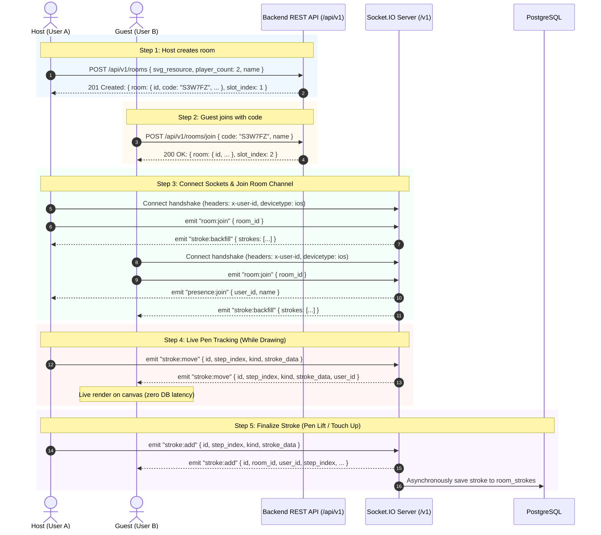

# Drawing Widget iOS & Canvas — Frontend Integration & Workflow Guide

Welcome! This guide is designed for the **Frontend (iOS / Canvas) Developer** to understand the exact end-to-end integration flow, API contracts, WebSocket events, and best practices for multiplayer drawing in the Drawing Widget app.

---

## Table of Contents
1. [High-Level Architecture](#1-high-level-architecture)
2. [Authentication & Common Headers](#2-authentication--common-headers)
3. [Step-by-Step Integration Workflow](#3-step-by-step-integration-workflow)
   - [Phase 1: Room Creation or Joining (REST HTTP)](#phase-1-room-creation-or-joining-rest-http)
   - [Phase 2: Connecting to WebSocket & Joining Room (Socket.IO)](#phase-2-connecting-to-websocket--joining-room-socketio)
   - [Phase 3: Live Drawing Synchronization (Pen Down ➔ Move ➔ Up)](#phase-3-live-drawing-synchronization-pen-down--move--up)
   - [Phase 4: Erasing Strokes](#phase-4-erasing-strokes)
   - [Phase 5: Canvas Backfill & Reconnection](#phase-5-canvas-backfill--reconnection)
   - [Phase 6: Real-Time In-Room Chat](#phase-6-real-time-in-room-chat)
   - [Phase 7: Leaving or Disconnecting](#phase-7-leaving-or-disconnecting)
4. [Complete API & WebSocket Event Reference](#4-complete-api--websocket-event-reference)
5. [Swift / iOS Code Implementation Examples](#5-swift--ios-code-implementation-examples)
6. [Frontend State & Canvas Best Practices](#6-frontend-state--canvas-best-practices)
7. [Error Handling & Edge Cases](#7-error-handling--edge-cases)

---

## 1. High-Level Architecture

The multiplayer drawing feature is split into two complementary layers:

```
┌─────────────────────────────────────────────────────────────────────────────┐
│                              FRONTEND (iOS APP)                             │
└───────────────────────┬─────────────────────────────┬───────────────────────┘
                        │                             │
               1. REST HTTP Requests          2. Real-Time Socket.IO
            (Room Setup, Join, Metadata)   (Streaming live pen & strokes)
                        │                             │
                        ▼                             ▼
┌───────────────────────────────────┐     ┌───────────────────────────────────┐
│     Express REST API (/api/v1)    │     │       Socket.IO Server (/v1)      │
│  - POST /api/v1/rooms             │     │  - stroke:move  (0ms DB delay)    │
│  - POST /api/v1/rooms/join        │     │  - stroke:add   (saved to DB)     │
│  - GET  /api/v1/rooms/:id         │     │  - stroke:erase (deleted in DB)   │
│  - GET  /api/v1/rooms/:id/strokes │     │  - stroke:backfill                │
└─────────────────┬─────────────────┘     └─────────────────┬─────────────────┘
                  │                                         │
                  └────────────────────┬────────────────────┘
                                       │
                                       ▼
                       ┌───────────────────────────────┐
                       │      PostgreSQL Database      │
                       │   rooms, room_members,        │
                       │   room_strokes, room_chats    │
                       └───────────────────────────────┘
```

- **REST HTTP (`/api/v1/rooms/*`)**: Used for atomic room operations (creating a room, validating 6-character room codes, reserving player slots, and leaving).
- **Socket.IO (`/v1` namespace)**: Used for ultra low-latency real-time interactions (streaming pen coordinates as you draw, broadcasting finalized strokes, erasing, and chat).

---

## 2. Authentication & Common Headers

All HTTP requests and WebSocket handshakes require two identifiers:

| Header / Param | Type | Required | Description | Example |
|---|---|---|---|---|
| `x-user-id` | `String` | **Yes** | Unique identifier of the current user (device UUID, auth ID, etc.). Min 2 characters. | `"usr_ios_8f3a9b"` |
| `devicetype` | `String` | Optional | Client platform. Defaults to `ios`. | `"ios"` |

> 💡 **Tip for iOS**: Generate a persistent UUID stored in `Keychain` or `UserDefaults` (e.g. `UUID().uuidString.lowercased()`) for `x-user-id` so the same user re-attaches to their slot upon reconnection.

---

## 3. Step-by-Step Integration Workflow



---

### Phase 1: Room Creation or Joining (REST HTTP)

#### Case A: User creates a new room (Host)
1. Call `POST /api/v1/rooms`
   - **Headers**:
     ```http
     x-user-id: usr_host_101
     devicetype: ios
     Content-Type: application/json
     ```
   - **Body**:
     ```json
     {
       "svg_resource": "flower_outline_01",
       "player_count": 2,
       "name": "Alice"
     }
     ```
   - **Response (`201 Created`)**:
     ```json
     {
       "success": true,
       "message": "Room created successfully.",
       "data": {
         "room": {
           "id": "114a29ed-193a-4b2b-873e-42d6cbcc02f2",
           "code": "S3W7FZ",
           "svg_resource": "flower_outline_01",
           "host_id": "usr_host_101",
           "player_count": 2,
           "device_type": "ios",
           "created_at": "2026-10-23T10:00:00.000Z"
         },
         "slot_index": 1
       }
     }
     ```
2. Save `data.room.id` and display `data.room.code` (e.g. `S3W7FZ`) on the UI for friends to join.

---

#### Case B: User joins an existing room (Guest)
1. User enters 6-character room code.
2. Call `POST /api/v1/rooms/join`
   - **Headers**:
     ```http
     x-user-id: usr_guest_202
     devicetype: ios
     Content-Type: application/json
     ```
   - **Body**:
     ```json
     {
       "code": "S3W7FZ",
       "name": "Bob"
     }
     ```
   - **Response (`200 OK`)**:
     ```json
     {
       "success": true,
       "message": "Joined room successfully.",
       "data": {
         "room": {
           "id": "114a29ed-193a-4b2b-873e-42d6cbcc02f2",
           "code": "S3W7FZ",
           "svg_resource": "flower_outline_01",
           "player_count": 2
         },
         "slot_index": 2
       }
     }
     ```

---

### Phase 2: Connecting to WebSocket & Joining Room (Socket.IO)

Immediately after obtaining `room_id`, connect your Socket.IO client:

1. **Connection URL**: `http://<SERVER_HOST>:<PORT>/v1` (Note namespace: `/v1`)
2. **Handshake Auth / Headers**:
   ```swift
   ["userId": "usr_host_101", "devicetype": "ios"]
   ```
3. **Emit `room:join` once connected**:
   ```json
   // Event: "room:join"
   {
     "room_id": "114a29ed-193a-4b2b-873e-42d6cbcc02f2"
   }
   ```
4. **Setup Listeners for Server Events**:
   - `stroke:backfill`: Receives existing canvas strokes to draw before starting.
   - `presence:join`: Another player joined the room `{ user_id, name }`.
   - `presence:leave`: A player left or disconnected `{ user_id }`.
   - `stroke:move`: Peer is actively moving their stylus/finger across the canvas.
   - `stroke:add`: Peer finished a stroke and it has been saved.
   - `stroke:erase`: Peer erased strokes.
   - `chat:add`: Real-time chat message from a peer.

---

### Phase 3: Live Drawing Synchronization (Pen Down ➔ Move ➔ Up)

For the best user experience with zero lag, drawing uses a two-tiered protocol:

#### 1. Stylus / Finger Down (`touchesBegan`)
- Generate a new stroke UUID: `let strokeId = UUID().uuidString.lowercased()`.
- Begin tracking points locally.

#### 2. Dragging / In-Progress Pen Movement (`touchesMoved`)
- Emit `stroke:move` at throttled intervals (e.g. 30–60 updates/sec):
  ```json
  // Event: "stroke:move" (Client -> Server)
  {
    "id": "11111111-1111-4111-8111-111111111111",
    "step_index": 1,
    "kind": "line",
    "stroke_data": "<base64-intermediate-points-or-drawing>"
  }
  ```
- **Backend Behavior**: The server immediately relays this to peers in the room with `user_id` attached with **0ms database delay**.
- **Peer Action**: Render the peer's cursor / preview stroke dynamically on a temporary overlay layer.

#### 3. Stylus / Finger Lift (`touchesEnded`)
- The stroke is now final!
- Emit `stroke:add`:
  ```json
  // Event: "stroke:add" (Client -> Server)
  {
    "id": "11111111-1111-4111-8111-111111111111",
    "step_index": 1,
    "kind": "line",
    "stroke_data": "<base64-pkdrawing-data>"
  }
  ```
- **Backend Behavior**:
  1. Broadcasts `stroke:add` event to all other room members.
  2. Asynchronously commits the stroke to PostgreSQL (`room_strokes` table).
- **Peer Action**: Replace the temporary preview layer for this stroke with the permanent rendered stroke in the main canvas drawing model.

---

### Phase 4: Erasing Strokes

When the user activates an eraser and removes one or more strokes:

1. Identify the deleted stroke UUIDs.
2. Emit `stroke:erase`:
   ```json
   // Event: "stroke:erase" (Client -> Server)
   {
     "stroke_ids": [
       "11111111-1111-4111-8111-111111111111"
     ],
     "step_index": 1
   }
   ```
3. **Backend Action**: Removes strokes from PostgreSQL and broadcasts `stroke:erase` to peers:
   ```json
   // Received by peers:
   {
     "room_id": "114a29ed-193a-4b2b-873e-42d6cbcc02f2",
     "user_id": "usr_host_101",
     "stroke_ids": ["11111111-1111-4111-8111-111111111111"],
     "step_index": 1
   }
   ```
4. **Peer Action**: Remove matching strokes from the local canvas and redraw.

---

### Phase 5: Canvas Backfill & Reconnection

Whenever a user joins or re-joins a room (e.g., app moved to background and resumed, or network drop):
1. **Automatic via Socket**: When sending `room:join`, the server automatically fires `stroke:backfill`:
   ```json
   // Event: "stroke:backfill" (Server -> Client)
   {
     "strokes": [
       {
         "id": "11111111-1111-4111-8111-111111111111",
         "room_id": "114a29ed-193a-4b2b-873e-42d6cbcc02f2",
         "user_id": "usr_host_101",
         "step_index": 1,
         "kind": "line",
         "stroke_data": "<base64-pkdrawing-data>",
         "created_at": "2026-10-23T10:05:00.000Z"
       }
     ]
   }
   ```
2. **Alternative via REST**: If you need to fetch historical strokes before socket connection, call:
   `GET /api/v1/rooms/:id/strokes`
3. **Canvas Action**: Loop through `strokes` in chronological order and append them to your `PKDrawing` or canvas engine.

---

### Phase 6: Real-Time In-Room Chat

If your UI includes an in-room chat box or reactions:

1. **Send Chat (Client -> Server)**:
   ```json
   // Event: "chat:add"
   {
     "message": "Let's draw flowers next!"
   }
   ```
2. **Receive Chat Broadcast (Server -> Peers)**:
   ```json
   // Event: "chat:add"
   {
     "id": "a5e8f421-2a9f-4318-87a4-a957c5e263ab",
     "room_id": "114a29ed-193a-4b2b-873e-42d6cbcc02f2",
     "user_id": "usr_guest_202",
     "name": "Bob",
     "message": "Let's draw flowers next!",
     "created_at": "2026-10-23T10:06:12.000Z"
   }
   ```

---

### Phase 7: Leaving or Disconnecting

When the user taps "Exit Room" or "Leave":
1. Call REST API: `POST /api/v1/rooms/leave` with `{ "room_id": "..." }`
2. Emit Socket event: `room:leave`
3. Disconnect socket connection: `socket.disconnect()`

---

## 4. Complete API & WebSocket Event Reference

### REST Endpoints Summary

| Method | Endpoint | Auth Required | Purpose |
|---|---|---|---|
| `POST` | `/api/v1/rooms` | Yes (`x-user-id`) | Create room (Returns `room.id`, `room.code`, `slot_index`) |
| `POST` | `/api/v1/rooms/join` | Yes (`x-user-id`) | Join via 6-char `code` (Returns `room.id`, `slot_index`) |
| `POST` | `/api/v1/rooms/leave` | Yes (`x-user-id`) | Leave room & free member slot |
| `GET` | `/api/v1/rooms/:id` | No | Get room status, player count, active members |
| `GET` | `/api/v1/rooms/:id/strokes` | No | Fetch all saved strokes for canvas restoration |
| `GET` | `/health` | No | Ping backend & database health |

---

### Socket.IO Events Summary (`/v1` namespace)

| Event Name | Direction | Payload Example | Description |
|---|---|---|---|
| `room:join` | Client ➔ Server | `{"room_id": "UUID"}` | Join room channel & trigger backfills |
| `room:leave` | Client ➔ Server | `{}` | Leave current room channel |
| `stroke:move` | Client ➔ Server | `{"id":"UUID", "step_index":1, "kind":"line", "stroke_data":"..."}` | Stream live pen coordinates (0ms DB delay) |
| `stroke:move` | Server ➔ Client | `{"id":"UUID", ..., "user_id":"..."}` | Receive peer's active pen position |
| `stroke:add` | Client ➔ Server | `{"id":"UUID", "step_index":1, "kind":"line", "stroke_data":"..."}` | Save finalized stroke on pen release |
| `stroke:add` | Server ➔ Client | `{"id":"UUID", ..., "user_id":"...", "created_at":"..."}` | Receive peer's completed stroke |
| `stroke:erase` | Client ➔ Server | `{"stroke_ids":["UUID"], "step_index":1}` | Erase stroke(s) |
| `stroke:erase` | Server ➔ Client | `{"stroke_ids":["UUID"], "user_id":"..."}` | Receive erase event from peer |
| `stroke:backfill`| Server ➔ Client | `{"strokes":[...]}` | Full stroke history on joining |
| `chat:add` | Client ➔ Server | `{"message":"Hello"}` | Send message to room |
| `chat:add` | Server ➔ Client | `{"id":"...", "user_id":"...", "name":"Bob", "message":"Hello", "created_at":"..."}` | Receive chat message |
| `presence:join` | Server ➔ Client | `{"user_id":"...", "name":"Alice"}` | Another player joined |
| `presence:leave`| Server ➔ Client | `{"user_id":"..."}` | Player left or disconnected |

---

## 5. Swift / iOS Code Implementation Examples

### 1. Socket.IO Client Configuration (Swift)

Using standard `SocketIO` CocoaPod / SPM (`Socket.IO-Client-Swift`):

```swift
import Foundation
import SocketIO
import PencilKit

class MultiplayerDrawingManager: ObservableObject {
    static let shared = MultiplayerDrawingManager()
    
    private var manager: SocketManager?
    private var socket: SocketIOClient?
    
    let baseURL = URL(string: "http://your-server-ip:3000")!
    let userId = UserDefaults.standard.string(forKey: "app_user_id") ?? UUID().uuidString.lowercased()
    
    var currentRoomId: String?
    
    func connectSocket(roomId: String) {
        self.currentRoomId = roomId
        
        // Connect to "/v1" namespace with authentication headers
        manager = SocketManager(
            socketURL: baseURL,
            config: [
                .log(true),
                .compress,
                .connectParams(["userId": userId, "devicetype": "ios"]),
                .extraHeaders(["x-user-id": userId, "devicetype": "ios"])
            ]
        )
        
        socket = manager?.socket(forNamespace: "/v1")
        
        setupListeners()
        socket?.connect()
    }
    
    private func setupListeners() {
        guard let socket = socket else { return }
        
        socket.on(clientEvent: .connect) { [weak self] _, _ in
            print("Connected to WebSocket namespace /v1")
            guard let roomId = self?.currentRoomId else { return }
            
            // Join the specific room
            socket.emit("room:join", ["room_id": roomId])
        }
        
        // 1. Backfill of existing strokes
        socket.on("stroke:backfill") { data, _ in
            guard let dict = data.first as? [String: Any],
                  let strokes = dict["strokes"] as? [[String: Any]] else { return }
            print("Received backfill strokes count: \(strokes.count)")
            // Restore strokes to Canvas/PKDrawing
        }
        
        // 2. Real-time pen move (streaming)
        socket.on("stroke:move") { data, _ in
            guard let dict = data.first as? [String: Any] else { return }
            let peerUserId = dict["user_id"] as? String
            let strokeData = dict["stroke_data"] as? String
            // Update peer cursor / temporary preview
        }
        
        // 3. Finalized stroke added by peer
        socket.on("stroke:add") { data, _ in
            guard let dict = data.first as? [String: Any] else { return }
            let strokeId = dict["id"] as? String
            let base64 = dict["stroke_data"] as? String
            // Append stroke to main PKDrawing
        }
        
        // 4. Erase event
        socket.on("stroke:erase") { data, _ in
            guard let dict = data.first as? [String: Any],
                  let strokeIds = dict["stroke_ids"] as? [String] else { return }
            // Remove matching strokes from local canvas
        }
        
        // 5. Presence events
        socket.on("presence:join") { data, _ in
            guard let dict = data.first as? [String: Any] else { return }
            print("Player joined: \(dict["name"] ?? "Anonymous")")
        }
        
        socket.on("presence:leave") { data, _ in
            guard let dict = data.first as? [String: Any] else { return }
            print("Player left: \(dict["user_id"] ?? "")")
        }
    }
    
    // --- Sending Actions ---
    
    /// Stream live stroke points while user is dragging
    func sendStrokeMove(strokeId: String, stepIndex: Int, base64Data: String) {
        socket?.emit("stroke:move", [
            "id": strokeId,
            "step_index": stepIndex,
            "kind": "line",
            "stroke_data": base64Data
        ])
    }
    
    /// Finalize stroke when touch/stylus ends
    func sendStrokeAdd(strokeId: String, stepIndex: Int, base64Data: String) {
        socket?.emit("stroke:add", [
            "id": strokeId,
            "step_index": stepIndex,
            "kind": "line",
            "stroke_data": base64Data
        ])
    }
    
    /// Erase stroke(s)
    func sendStrokeErase(strokeIds: [String], stepIndex: Int) {
        socket?.emit("stroke:erase", [
            "stroke_ids": strokeIds,
            "step_index": stepIndex
        ])
    }
    
    func leaveRoom() {
        socket?.emit("room:leave", [:])
        socket?.disconnect()
    }
}
```

---

### 2. Converting PencilKit (`PKDrawing`) to Base64 & Back

```swift
import PencilKit

extension PKDrawing {
    /// Convert drawing or single stroke representation to base64 for socket transmission
    func toBase64() -> String {
        return self.dataRepresentation().base64EncodedString()
    }
    
    /// Recreate PKDrawing from base64 received from socket or REST backfill
    static func fromBase64(_ base64String: String) -> PKDrawing? {
        guard let data = Data(base64Encoded: base64String) else { return nil }
        return try? PKDrawing(data: data)
    }
}
```

---

## 6. Frontend State & Canvas Best Practices

1. **Two Canvas Layers**:
   - **Main Layer (`PKCanvasView`)**: Holds permanent, confirmed strokes (received via `stroke:add` or `stroke:backfill`).
   - **Ghost / Preview Layer (`UIView` or sub-canvas)**: Holds active strokes being drawn by peers (received via `stroke:move`). When `stroke:add` arrives for that stroke ID, clear the ghost stroke and bake it into the main layer.
2. **Unique Stroke IDs**: Always generate a lowercase UUID on `touchesBegan` (e.g. `UUID().uuidString.lowercased()`).
3. **Throttling `stroke:move`**: Do not emit `stroke:move` on every single sub-pixel coordinate if sampling at >120Hz on iPad Pro. Throttle socket emission to ~30–60Hz to conserve battery and stay well within the server rate limiter (50 ops/sec, burst 200).
4. **Color coding by Slot Index**: Use `slot_index` (1 to 4) to assign distinct player colors (e.g. Slot 1 = Blue, Slot 2 = Coral, Slot 3 = Emerald, Slot 4 = Amber) so users know who is drawing what.

---

## 7. Error Handling & Edge Cases

| Status / Error | Cause | What Frontend Should Do |
|---|---|---|
| `401 Unauthorized` | Missing `x-user-id` header or invalid handshake | Ensure `x-user-id` header is attached to all HTTP requests and socket handshake. |
| `404 Not Found` (Join Room) | Room code does not exist or expired | Show alert: *"Room code not found. Please double check the 6-character code."* |
| `400 Bad Request` (Platform Mismatch) | Trying to join an iOS room from Android or vice versa | Show alert: *"This room is on another platform."* |
| `400 / 422 Room Full` | All slots (2 to 4) occupied | Show alert: *"This room is currently full."* |
| `Socket disconnect` (Network drop) | WiFi / Cellular glitch | Socket.IO will auto-reconnect. On reconnect, re-emit `room:join` with current `room_id` to get `stroke:backfill` for any missed strokes. |

---

### Need Help or API Testing?
- You can test any of these endpoints and Socket events directly using the included Postman collection: `Drawing Widget iOS Backend API.postman_collection.json`.
- Refer to `POSTMAN_TESTING_GUIDE.md` for pre-configured request samples and step-by-step Postman instructions.
