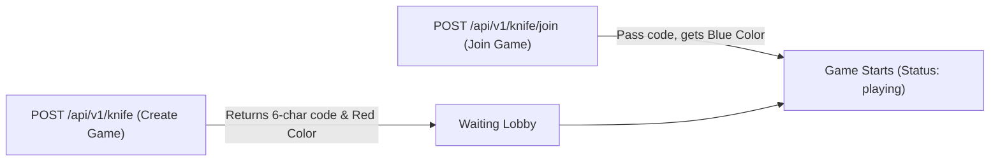

# Knife Game Multiplayer: iOS Frontend Developer Cheat Sheet

A comprehensive, developer-ready specification and cheat sheet for integrating the **Knife Game Multiplayer** backend in iOS (Swift) using **REST** and **Socket.IO**.

---

## 1. Connection & Handshake Authentication

- **Socket.IO Base URL:** `https://drawing-widget-backend.onrender.com/v1` *(or `http://localhost:3000/v1` for local dev)*
- **Namespace:** `/v1`
- **Transport:** `websocket`

### Handshake Auth & Headers

Pass these in your Socket.IO client configuration:

| Parameter | Type | Required | Description | Example |
| :--- | :--- | :---: | :--- | :--- |
| `userId` / `x-user-id` | `String` | **Yes** | Client user identifier (min 2 chars) | `"knife_user_001"` |
| `devicetype` | `String` | Optional | Device platform (`"ios"` or `"android"`) | `"ios"` |
| `name` | `String` | Optional | User display name | `"Alice"` |
| `profileImage` | `String` | Optional | User avatar identifier | `"A7"` |

```swift
let manager = SocketManager(
    socketURL: URL(string: "https://drawing-widget-backend.onrender.com/v1")!,
    config: [
        .log(false),
        .compress,
        .forceWebsockets(true),
        .connectParams([
            "userId": currentUserId,
            "devicetype": "ios",
            "name": currentUserName,
            "profileImage": currentAvatarId // e.g. "A7"
        ])
    ]
)
let socket = manager.defaultSocket
```

---

## 2. REST Lobby Endpoints

All REST requests require the `x-user-id` header. Responses are wrapped in `{ success, message, data }`.



### 2.1 Create Game (Host - Red)
- **Endpoint:** `POST /api/v1/knife`
- **Headers:** `x-user-id: <USER_ID>`, `devicetype: ios`, `Content-Type: application/json`
- **Body:**
  ```json
  {
    "name": "Alice",
    "profile_image": "A7"
  }
  ```
- **Response (`201 Created`):**
  ```json
  {
    "success": true,
    "message": "Game created successfully.",
    "data": {
      "game": {
        "id": "e4b3c2d1-0000-4000-8000-abcdef123456",
        "code": "KM8Y2X",
        "host_id": "knife_user_001",
        "status": "waiting",
        "round": 1,
        "level": 1,
        "scores": { "red": 0, "blue": 0 },
        "lives": { "red": 3, "blue": 3 },
        "config": {
          "lives": 3,
          "knife_touch_deg": 13.5,
          "apple_touch_deg": 14.0,
          "level_pause_ms": 1000
        }
      },
      "color": "red",
      "players": [
        { "user_id": "knife_user_001", "color": "red", "name": "Alice", "profile_image": "A7" }
      ]
    }
  }
  ```

### 2.2 Join Game via Code (Guest - Blue)
- **Endpoint:** `POST /api/v1/knife/join`
- **Headers:** `x-user-id: <USER_ID>`, `devicetype: ios`, `Content-Type: application/json`
- **Body:**
  ```json
  {
    "code": "KM8Y2X",
    "name": "Bob",
    "profile_image": "B3"
  }
  ```
- **Response (`200 OK`):**
  ```json
  {
    "success": true,
    "message": "Joined game successfully.",
    "data": {
      "game": {
        "id": "e4b3c2d1-0000-4000-8000-abcdef123456",
        "status": "playing",
        "current_turn": "red",
        "level_started_at": 1795400001000
      },
      "color": "blue",
      "players": [...]
    }
  }
  ```
  > [!TIP]
  > Calling `POST /api/v1/knife/join` again with the same `user_id` safely returns the existing seat with no error.

### 2.3 Lookup Game Details
- **By ID:** `GET /api/v1/knife/:id`
- **By Room Code:** `GET /api/v1/knife/code/:code`

---

## 3. Game Rules & Hit Mathematics

```text
               0° (Top)
                 │
      270° ──────┼────── 90°
                 │
               180°
```

1. **Angle Space:** Decimals from `0.0°` to `359.9°` in the log's own rotational frame.
2. **Angle Gap Formula:**
   $$d = |a - b| \bmod 360, \quad \text{gap} = \min(d,\ 360 - d)$$
3. **Clank Rule:**
   - If $\text{gap} < 13.5^\circ$ to **any** knife currently stuck on the log:
     - Result is `"clank"`.
     - Thrower loses 1 heart (`lives - 1`).
     - Knife does **not** stick to the log.
     - `0` points awarded, `apples_cut: []`.
4. **Stick Rule:**
   - If $\text{gap} \ge 13.5^\circ$ to all stuck knives:
     - Result is `"stick"`.
     - Knife is added to `stuck_knives`.
     - Every uncut apple with $\text{gap} < 14.0^\circ$ is cut (+1 point each).
5. **Level Cleared:**
   - Triggered when all apples on the current log are cut.
   - `level` increments by 1.
   - `stuck_knives` are cleared (`[]`).
   - New apples spawn: $\min(2 + 2 \times \text{level},\ 20)$.
   - `level_started_at = now + 1000ms`. Throws before this timestamp are rejected with `LEVEL_STARTING`.
6. **Game Over & Winner Resolution:**
   - Triggers when either player's hearts reach `0`.
   - **The player with the HIGHER SCORE wins, NOT the player with hearts left!**
   - If scores are equal: `is_draw: true`, `winner: null`.
7. **Turns:**
   - Turns alternate after every throw (stick or clank).
   - **Round 1:** Red throws first.
   - **Round 2 (Rematch):** Blue throws first.

---

## 4. Client ➔ Server Socket Events (iOS Emits)

Always use `emitWithAck` to receive confirmation or structured error payloads.

### 4.1 `knife:game:join`
Join the game channel upon opening the game view or reconnecting.
```swift
socket.emitWithAck("knife:game:join", ["game_id": gameId]).timingOut(after: 5) { data in
    guard let res = data.first as? [String: Any], res["ok"] as? Bool == true else { return }
    let myColor = res["your_color"] as? String // "red" or "blue"
    let game = res["game"] as? [String: Any]
}
```

### 4.2 `knife:throw`
Emitted when the player taps to launch a knife.
```swift
let payload: [String: Any] = [
    "game_id": gameId,
    "throw_number": nextExpectedThrowNumber, // Integer: 1, 2, 3...
    "level": currentLevel,                   // Integer: 1, 2, 3...
    "angle": landingAngle                    // Double: 0.0 to 359.9 (MUST be numeric Double; string "45" is rejected with INVALID_ANGLE)
]

socket.emitWithAck("knife:throw", payload).timingOut(after: 5) { data in
    guard let res = data.first as? [String: Any] else { return }
    if res["ok"] as? Bool == true {
        let result = res["result"] as? String // "stick" or "clank"
        let points = res["points"] as? Int
        let applesCut = res["apples_cut"] as? [Int]
        let nextTurn = res["next_turn"] as? String
        let isLevelCleared = res["level_cleared"] as? Bool
        let isGameOver = res["game_over"] as? Bool
    } else {
        // Error codes:
        // - "STALE_THROW": Duplicate/retried throw number or level mismatch (checked BEFORE turn)
        // - "INVALID_ANGLE": Non-numeric or out-of-range angle
        // - "NOT_YOUR_TURN": Throwing when it is not your turn
        // - "LEVEL_STARTING": Throwing during the 1,000ms level break
        let reason = res["reason"] as? String
    }
}
```

### 4.3 `knife:rematch:request`
Ask opponent for a rematch after the match has finished.
> **Note:** Duplicate requests from the same user acknowledge `{ ok: true }` without spamming the opponent. Mutual requests by both players automatically trigger the match restart.
```swift
socket.emitWithAck("knife:rematch:request", ["game_id": gameId]).timingOut(after: 5) { data in
    guard let res = data.first as? [String: Any] else { return }
    if res["ok"] as? Bool == true {
        // Server acknowledged request; opponent receives "knife:rematch:requested"
    } else {
        // reason == "OPPONENT_LEFT" (opponent exited room or match abandoned)
        let reason = res["reason"] as? String
    }
}
```

### 4.4 `knife:rematch:respond`
Respond to a rematch request from the opponent.
> **Note:** Requires a pending request from the opponent. You cannot answer your own rematch request, and you cannot accept after a decline.
```swift
socket.emitWithAck("knife:rematch:respond", [
    "game_id": gameId,
    "accept": true // or false
]).timingOut(after: 5) { data in
    guard let res = data.first as? [String: Any] else { return }
    if res["ok"] as? Bool == true {
        if let accepted = res["accepted"] as? Bool, !accepted {
            // Rematch was declined
        } else {
            // Rematch accepted! (BOTH players receive "knife:game:restarted")
            let game = res["game"] as? [String: Any]
        }
    } else {
        // Error codes:
        // - "NO_REMATCH_REQUEST": No request open, or already declined
        // - "CANNOT_ACCEPT_OWN_REMATCH": Tried answering own request
        // - "OPPONENT_LEFT": Opponent left room
        let reason = res["reason"] as? String
    }
}
```

### 4.5 `knife:game:leave`
Voluntarily leave an active match (forfeits game to opponent).
```swift
socket.emitWithAck("knife:game:leave", ["game_id": gameId]).timingOut(after: 5) { _ in }
```

### 4.6 `knife:time`
Clock synchronization ping to measure network latency.
```swift
socket.emitWithAck("knife:time", [:]).timingOut(after: 2) { data in
    guard let res = data.first as? [String: Any] else { return }
    let serverTime = res["server_time"] as? Double
}
```

---

## 5. Server ➔ Client Socket Events (iOS Listens to)

Register these in your ViewController / ViewModel:

### 5.1 `knife:thrown`
Broadcast to both players whenever a knife is thrown.
```swift
socket.on("knife:thrown") { data, _ in
    guard let res = data.first as? [String: Any] else { return }
    let throwerColor = res["color"] as? String
    let angle = res["angle"] as? Double
    let result = res["result"] as? String // "stick" or "clank"
    let scores = res["scores"] as? [String: Int]
    let lives = res["lives"] as? [String: Int]
    let nextTurn = res["next_turn"] as? String
    
    // 1. Animate knife landing at 'angle'
    // 2. If 'clank': trigger bounce animation and shake screen
    // 3. If 'stick': stick knife to log and animate cut apples
    // 4. Update scoreboard and hearts
}
```

### 5.2 `knife:game:over`
Broadcast when either player's lives reach `0` or on forfeit.
```swift
socket.on("knife:game:over") { data, _ in
    guard let res = data.first as? [String: Any] else { return }
    let winner = res["winner"] as? String       // "red", "blue", or nil (Draw)
    let reason = res["reason"] as? String       // "SCORE", "OPPONENT_LEFT", "OPPONENT_DISCONNECTED"
    let scores = res["scores"] as? [String: Int]
    let isDraw = res["is_draw"] as? Bool ?? false
    
    // Display Game Over Modal with Winner Announcement and Rematch button
}
```

### 5.3 `knife:rematch:requested`
Received when the opponent asks for a rematch.
```swift
socket.on("knife:rematch:requested") { data, _ in
    // Display alert dialog: "Opponent wants a rematch! Accept?" [Accept] [Decline]
    // Call socket.emitWithAck("knife:rematch:respond", ["game_id": id, "accept": true/false])
}
```

### 5.4 `knife:rematch:declined`
Received by the requester if opponent declines.
```swift
socket.on("knife:rematch:declined") { _, _ in
    // Show toast: "Rematch was declined."
}
```

### 5.5 `knife:game:restarted`
Broadcast to both players when a rematch starts.
```swift
socket.on("knife:game:restarted") { data, _ in
    guard let res = data.first as? [String: Any],
          let game = res["game"] as? [String: Any] else { return }
    
    // 1. Reset board to Level 1
    // 2. Clear stuck knives
    // 3. Scores = 0, Hearts = 3
    // 4. Note: Blue throws first in Round 2!
}
```

### 5.6 `knife:player:disconnected`
Broadcast when opponent loses internet connection or backgrounds the app.
```swift
socket.on("knife:player:disconnected") { data, _ in
    // Display banner: "Opponent disconnected. 60s reconnection grace period..."
}
```

### 5.7 `knife:player:joined`
Broadcast to the room when the opponent joins (fires immediately when the guest joins via REST `POST /api/v1/knife/join` or connects via socket, notifying the host straight away without polling).
```swift
socket.on("knife:player:joined") { data, _ in
    guard let res = data.first as? [String: Any],
          let game = res["game"] as? [String: Any],
          let players = res["players"] as? [[String: Any]] else { return }
    
    // Host UI: Opponent entered room / joined over REST; update lobby screen
}
```

### 5.8 `knife:game:started`
Broadcast to **both players** strictly **once per round** when both players are connected and ready.
```swift
socket.on("knife:game:started") { data, _ in
    guard let res = data.first as? [String: Any],
          let game = res["game"] as? [String: Any] else { return }
    
    // Start initial countdown & log rotation animation
}
```

### 5.9 `knife:player:left`
Broadcast when opponent voluntarily exits or times out.
```swift
socket.on("knife:player:left") { data, _ in
    // Opponent left; game ends by forfeit
}
```

---

## 6. Error Codes & UI Recommendations

| Error `code` | Error `reason` | Cause | Recommended UI Action |
| :--- | :--- | :--- | :--- |
| `THROW_FAILED` | `NOT_YOUR_TURN` | Player threw on opponent's turn | Subtle haptic warning, ignore tap |
| `THROW_FAILED` | `STALE_THROW` | Duplicate/re-sent throw number or level mismatch | Re-sync `throw_number` from last state |
| `THROW_FAILED` | `LEVEL_STARTING` | Threw during 1,000ms level break | Wait for `level_started_at` log spin |
| `THROW_FAILED` | `INVALID_ANGLE` | Angle is non-numeric, NaN, or outside 0..<360 | Pass strict numeric Double |
| `THROW_FAILED` | `GAME_NOT_ACTIVE` | Threw before start or after end | Ignore throw |
| `REMATCH_FAILED` | `NO_REMATCH_REQUEST` | Called rematch respond when no request was open (or after decline) | Keep Rematch button active to request rematch |
| `REMATCH_FAILED` | `CANNOT_ACCEPT_OWN_REMATCH` | Requester attempted to accept their own request | Wait for opponent to respond |
| `REMATCH_FAILED` | `GAME_NOT_FINISHED` | Tap rematch mid-match | Disable rematch button until game over |
| `REMATCH_FAILED` | `OPPONENT_LEFT` | Opponent already exited room or timed out | Disable rematch, show "Return to Lobby" |
| `NOT_IN_GAME` | `NOT_IN_GAME` | Player has left or was never in the game | Return to Lobby screen |

---

## 7. Swift Implementation Template

```swift
import Foundation
import SocketIO

final class KnifeGameSocketManager {
    static let shared = KnifeGameSocketManager()
    
    private var manager: SocketManager?
    private var socket: SocketIOClient?
    
    func connect(userId: String, name: String, avatar: String) {
        let url = URL(string: "https://drawing-widget-backend.onrender.com/v1")!
        manager = SocketManager(socketURL: url, config: [
            .log(false),
            .forceWebsockets(true),
            .connectParams([
                "userId": userId,
                "devicetype": "ios",
                "name": name,
                "profileImage": avatar
            ])
        ])
        socket = manager?.defaultSocket
        setupListeners()
        socket?.connect()
    }
    
    private func setupListeners() {
        guard let socket = socket else { return }
        
        socket.on("knife:player:joined") { data, _ in
            guard let dict = data.first as? [String: Any] else { return }
            NotificationCenter.default.post(name: .onKnifePlayerJoined, object: dict)
        }
        
        socket.on("knife:game:started") { data, _ in
            guard let dict = data.first as? [String: Any] else { return }
            NotificationCenter.default.post(name: .onKnifeGameStarted, object: dict)
        }
        
        socket.on("knife:thrown") { data, _ in
            guard let dict = data.first as? [String: Any] else { return }
            NotificationCenter.default.post(name: .onKnifeThrown, object: dict)
        }
        
        socket.on("knife:game:over") { data, _ in
            guard let dict = data.first as? [String: Any] else { return }
            NotificationCenter.default.post(name: .onKnifeGameOver, object: dict)
        }
        
        socket.on("knife:rematch:requested") { data, _ in
            guard let dict = data.first as? [String: Any] else { return }
            NotificationCenter.default.post(name: .onKnifeRematchRequested, object: dict)
        }
        
        socket.on("knife:rematch:declined") { data, _ in
            guard let dict = data.first as? [String: Any] else { return }
            NotificationCenter.default.post(name: .onKnifeRematchDeclined, object: dict)
        }
        
        socket.on("knife:game:restarted") { data, _ in
            guard let dict = data.first as? [String: Any] else { return }
            NotificationCenter.default.post(name: .onKnifeGameRestarted, object: dict)
        }
        
        socket.on("knife:player:disconnected") { data, _ in
            guard let dict = data.first as? [String: Any] else { return }
            NotificationCenter.default.post(name: .onKnifePlayerDisconnected, object: dict)
        }
        
        socket.on("knife:player:left") { data, _ in
            guard let dict = data.first as? [String: Any] else { return }
            NotificationCenter.default.post(name: .onKnifePlayerLeft, object: dict)
        }
    }
    
    func sendThrow(gameId: String, throwNumber: Int, level: Int, angle: Double, completion: @escaping (Bool, [String: Any]?) -> Void) {
        let payload: [String: Any] = [
            "game_id": gameId,
            "throw_number": throwNumber,
            "level": level,
            "angle": angle
        ]
        socket?.emitWithAck("knife:throw", payload).timingOut(after: 4) { data in
            guard let res = data.first as? [String: Any] else {
                completion(false, nil)
                return
            }
            let isOk = res["ok"] as? Bool ?? false
            completion(isOk, res)
        }
    }
}
```
    
    func sendThrow(gameId: String, throwNumber: Int, level: Int, angle: Double, completion: @escaping (Bool, [String: Any]?) -> Void) {
        let payload: [String: Any] = [
            "game_id": gameId,
            "throw_number": throwNumber,
            "level": level,
            "angle": angle
        ]
        socket?.emitWithAck("knife:throw", payload).timingOut(after: 4) { data in
            guard let res = data.first as? [String: Any] else {
                completion(false, nil)
                return
            }
            let isOk = res["ok"] as? Bool ?? false
            completion(isOk, res)
        }
    }
}
```
