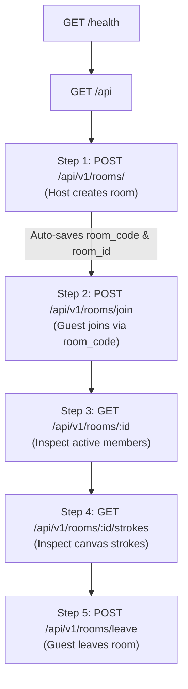

# Complete Postman Testing Guide: Drawing Widget iOS Backend

This guide provides end-to-end instructions for testing the **Drawing Widget iOS Backend** using **Postman**. It covers server setup, importing the included collection, testing all REST HTTP endpoints (happy path and error cases), and testing real-time **Socket.IO** live drawing events using Postman's native Socket.IO client.

---

## Table of Contents

1. [System & Architecture Overview](#1-system--architecture-overview)
2. [Prerequisites & Server Startup](#2-prerequisites--server-startup)
3. [Importing Collection into Postman](#3-importing-collection-into-postman)
4. [Collection Variables Setup](#4-collection-variables-setup)
5. [Testing REST API Endpoints (Step-by-Step)](#5-testing-rest-api-endpoints-step-by-step)
   - [Step 1: Health Check (`GET /health`)](#step-1-health-check-get-health)
   - [Step 2: API Base Info (`GET /api`)](#step-2-api-base-info-get-api)
   - [Step 3: Create Room (Host) (`POST /api/v1/rooms/`)](#step-3-create-room-host-post-apiv1rooms)
   - [Step 4: Join Room (Guest) (`POST /api/v1/rooms/join`)](#step-4-join-room-guest-post-apiv1roomsjoin)
   - [Step 5: Get Room Details & Members (`GET /api/v1/rooms/:id`)](#step-5-get-room-details--members-get-apiv1roomsid)
   - [Step 6: Get Room Strokes / Backfill (`GET /api/v1/rooms/:id/strokes`)](#step-6-get-room-strokes--backfill-get-apiv1roomsidstrokes)
   - [Step 7: Leave Room (`POST /api/v1/rooms/leave`)](#step-7-leave-room-post-apiv1roomsleave)
6. [Testing Validation & Error Scenarios](#6-testing-validation--error-scenarios)
7. [Running Automated Tests in Postman Collection Runner](#7-running-automated-tests-in-postman-collection-runner)
8. [Testing Real-Time Socket.IO Live Drawing in Postman](#8-testing-real-time-socketio-live-drawing-in-postman)
   - [Connecting to Socket.IO Namespace](#81-connecting-to-socketio-namespace)
   - [Joining the Room (`room:join`)](#82-joining-the-room-roomjoin)
   - [Testing Live Pen Streaming (`stroke:move`)](#83-testing-live-pen-streaming-strokemove)
   - [Testing Final Stroke Add & DB Persistence (`stroke:add`)](#84-testing-final-stroke-add--db-persistence-strokeadd)
   - [Testing Erasing Strokes (`stroke:erase`)](#85-testing-erasing-strokes-strokeerase)
   - [Testing Real-time Chat (`chat:add`)](#86-testing-real-time-chat-chatadd)
   - [Disconnecting & Presence (`presence:leave`)](#87-disconnecting--presence-presenceleave)
9. [Troubleshooting & FAQs](#9-troubleshooting--faqs)

---

## 1. System & Architecture Overview

The backend is built with **Node.js (ES Modules)**, **Express 5**, **Socket.IO 4**, and **PostgreSQL**.

### Key Rules & Requirements:
- **Header Authentication**: All room-related HTTP requests require:
  - `x-user-id` (string, min 2 chars): Identifies the user (e.g., `user_host_101`).
  - `devicetype` (string, optional): `ios` (default) or `android`.
- **Dynamic Variable Passing**: In Postman, creating a room dynamically saves `room_id` and `room_code` so you do not have to copy-paste them manually into subsequent requests.

---

## 2. Prerequisites & Server Startup

### Step 2.1: Verify Dependencies
Ensure Node.js (v18+) is installed. Open your terminal in the project directory:
```bash
cd /Users/pc/Documents/drawing-widget-ios-backend
npm install
```

### Step 2.2: Check Environment Variables (`.env`)
Make sure `.env` exists in the project root with the correct PostgreSQL connection string:
```env
PORT=3000
NODE_ENV=development
DATABASE_URL=postgres://postgres@localhost:5432/drawing_widget_ios
DATABASE_SSL=false
ROOM_TTL_HOURS=24
ROOM_REAP_INTERVAL_MINUTES=60
```

### Step 2.3: Run Database Migrations (One-time)
Create the required tables (`rooms`, `room_members`, `room_strokes`, `room_android_strokes`, `room_chats`):
```bash
npm run db:migrate
```

### Step 2.4: Start the Server
Start the development server with file auto-reloading:
```bash
npm run dev
```
You should see:
```text
[INFO] Server running on port 3000 in development mode
[INFO] Socket.IO initialized on "/" and "/v1" namespaces
```

> **Note**: Leave this terminal running while testing in Postman.

---

## 3. Importing Collection into Postman

The project includes a ready-to-use Postman collection at:
`postman_collection.json`

### Import Instructions:
1. Open **Postman**.
2. Click the **Import** button in the top-left corner (or press `Cmd + O` / `Ctrl + O`).
3. Drag and drop the `postman_collection.json` file from `/Users/pc/Documents/drawing-widget-ios-backend/postman_collection.json` into Postman, or click **files** and select it.
4. Click **Import**.
5. You will see a new collection titled **"Drawing Widget iOS Backend API"** in your left sidebar.

---

## 4. Collection Variables Setup

Click on the collection name **"Drawing Widget iOS Backend API"** and switch to the **Variables** tab. Verify the following variables:

| Variable | Initial Value | Current Value | Description |
|---|---|---|---|
| `base_url` | `http://localhost:3000` | `http://localhost:3000` | Backend API server URL |
| `user_host` | `user_host_101` | `user_host_101` | Test identifier for Host user |
| `user_guest` | `user_guest_202` | `user_guest_202` | Test identifier for Guest user |
| `room_id` | *(empty)* | *(auto-set by Step 1)* | Stored Room UUID |
| `room_code` | *(empty)* | *(auto-set by Step 1)* | Stored 6-char Room Code |

---

## 5. Testing REST API Endpoints (Step-by-Step)

Follow this testing order for the **Multiplayer Rooms (Happy Path)** workflow.



---

### Step 1: Health Check (`GET /health`)

- **Folder**: `1. Health & Status`
- **Request Name**: `Health Check`
- **Method**: `GET`
- **URL**: `{{base_url}}/health`
- **Headers**: *(None required)*
- **Action**: Click **Send**.
- **Expected Status**: `200 OK`
- **Expected Response Body**:
```json
{
  "status": "ok",
  "database": "connected",
  "timestamp": "2026-10-22T03:39:01.743Z"
}
```
- **Automated Tests**:
  - `Status code is 200` (Passed)
  - `Server status is ok and database is connected` (Passed)

---

### Step 2: API Base Info (`GET /api`)

- **Folder**: `1. Health & Status`
- **Request Name**: `API Base Info`
- **Method**: `GET`
- **URL**: `{{base_url}}/api`
- **Action**: Click **Send**.
- **Expected Status**: `200 OK`
- **Expected Response Body**:
```json
{
  "message": "Drawing Widget API is online",
  "version": "1.0.0",
  "endpoints": {
    "rooms": "/api/v1/rooms"
  }
}
```

---

### Step 3: Create Room (Host) (`POST /api/v1/rooms/`)

- **Folder**: `2. Multiplayer Rooms (Happy Path)`
- **Request Name**: `Step 1: Create Room (User 1 - Host)`
- **Method**: `POST`
- **URL**: `{{base_url}}/api/v1/rooms/`
- **Headers**:
  - `Content-Type`: `application/json`
  - `x-user-id`: `{{user_host}}` *(e.g., user_host_101)*
  - `devicetype`: `ios`
- **Body** (`raw` JSON):
```json
{
  "svg_resource": "<svg>cat_outline_template</svg>",
  "player_count": 2,
  "name": "Alice (Host)"
}
```
- **Action**: Click **Send**.
- **Expected Status**: `201 Created`
- **Expected Response Body**:
```json
{
  "success": true,
  "message": "Room created successfully.",
  "data": {
    "room": {
      "id": "e96395b2-3023-45f8-8ecf-6ff27a4d46c8",
      "code": "X7K2PQ",
      "svg_resource": "<svg>cat_outline_template</svg>",
      "host_id": "user_host_101",
      "player_count": 2,
      "device_type": "ios",
      "created_at": "2026-10-22T03:45:00.000Z",
      "started_at": null
    },
    "slot_index": 1
  }
}
```
- **Magic Behind the Scenes (Postman Test Script)**:
  The response automatically extracts:
  - `room.id` -> saved to variable `{{room_id}}`
  - `room.code` -> saved to variable `{{room_code}}`
  You will see `Room Code saved: X7K2PQ` in the Postman Console (`Cmd + Option + C`).

---

### Step 4: Join Room (Guest) (`POST /api/v1/rooms/join`)

- **Folder**: `2. Multiplayer Rooms (Happy Path)`
- **Request Name**: `Step 2: Join Room (User 2 - Guest)`
- **Method**: `POST`
- **URL**: `{{base_url}}/api/v1/rooms/join`
- **Headers**:
  - `Content-Type`: `application/json`
  - `x-user-id`: `{{user_guest}}` *(e.g., user_guest_202)*
  - `devicetype`: `ios`
- **Body** (`raw` JSON):
```json
{
  "code": "{{room_code}}",
  "name": "Bob (Guest)"
}
```
- **Action**: Click **Send**.
- **Expected Status**: `200 OK`
- **Expected Response Body**:
```json
{
  "success": true,
  "message": "Joined room successfully.",
  "data": {
    "room": {
      "id": "e96395b2-3023-45f8-8ecf-6ff27a4d46c8",
      "code": "X7K2PQ",
      "svg_resource": "<svg>cat_outline_template</svg>",
      "host_id": "user_host_101",
      "player_count": 2,
      "device_type": "ios"
    },
    "slot_index": 2
  }
}
```
> **Verification**: `slot_index` is allocated to `2`, distinct from Alice's slot `1`.

---

### Step 5: Get Room Details & Members (`GET /api/v1/rooms/:id`)

- **Folder**: `2. Multiplayer Rooms (Happy Path)`
- **Request Name**: `Step 3: Get Room Details & Active Members`
- **Method**: `GET`
- **URL**: `{{base_url}}/api/v1/rooms/{{room_id}}`
- **Headers**:
  - `x-user-id`: `{{user_host}}`
- **Action**: Click **Send**.
- **Expected Status**: `200 OK`
- **Expected Response Body**:
```json
{
  "success": true,
  "message": "Room details retrieved.",
  "data": {
    "room": {
      "id": "e96395b2-3023-45f8-8ecf-6ff27a4d46c8",
      "code": "X7K2PQ",
      "svg_resource": "<svg>cat_outline_template</svg>",
      "player_count": 2,
      "device_type": "ios"
    },
    "members": [
      {
        "user_id": "user_host_101",
        "slot_index": 1,
        "name": "Alice (Host)",
        "joined_at": "2026-10-22T03:45:00.000Z"
      },
      {
        "user_id": "user_guest_202",
        "slot_index": 2,
        "name": "Bob (Guest)",
        "joined_at": "2026-10-22T03:45:05.000Z"
      }
    ]
  }
}
```
> **Verification**: Both players are active members in the room with assigned slots.

---

### Step 6: Get Room Strokes / Backfill (`GET /api/v1/rooms/:id/strokes`)

- **Folder**: `2. Multiplayer Rooms (Happy Path)`
- **Request Name**: `Step 4: Get Room Strokes (Canvas Backfill)`
- **Method**: `GET`
- **URL**: `{{base_url}}/api/v1/rooms/{{room_id}}/strokes`
- **Headers**:
  - `x-user-id`: `{{user_guest}}`
- **Action**: Click **Send**.
- **Expected Status**: `200 OK`
- **Expected Response Body**:
```json
{
  "success": true,
  "message": "Room strokes retrieved.",
  "data": {
    "strokes": []
  }
}
```
*(If strokes were drawn via Socket.IO, they will appear here in chronological order).*

---

### Step 7: Leave Room (`POST /api/v1/rooms/leave`)

- **Folder**: `2. Multiplayer Rooms (Happy Path)`
- **Request Name**: `Step 5: Leave Room (User 2)`
- **Method**: `POST`
- **URL**: `{{base_url}}/api/v1/rooms/leave`
- **Headers**:
  - `Content-Type`: `application/json`
  - `x-user-id`: `{{user_guest}}`
- **Body** (`raw` JSON):
```json
{
  "room_id": "{{room_id}}"
}
```
- **Action**: Click **Send**.
- **Expected Status**: `200 OK`
- **Expected Response Body**:
```json
{
  "success": true,
  "message": "Left room successfully.",
  "data": {
    "remaining_members": 1
  }
}
```
> **Verification**: `remaining_members` drops to `1` (Host remains).

---

## 6. Testing Validation & Error Scenarios

Open the folder **`3. Validation & Error Handling`** to test how the backend handles bad inputs:

| Request Name | Trigger Condition | Expected Status | Expected Error Message |
|---|---|---|---|
| `Error: Missing Auth Header (401)` | Omit `x-user-id` header | `401 Unauthorized` | `Missing or invalid user id header (x-user-id)` |
| `Error: Invalid devicetype Header (400)` | Pass `devicetype: windows_phone` | `400 Bad Request` | `Invalid devicetype. Must be 'ios' or 'android'.` |
| `Error: Join Non-Existent Room Code (404)` | Pass code `ZZZZZZ` | `404 Not Found` | `No room found with code ZZZZZZ` |
| `Error: Invalid Player Count (422)` | Pass `player_count: 10` | `422 Unprocessable` | `player_count must be between 2 and 4` |

---

## 7. Running Automated Tests in Postman Collection Runner

You can execute all test cases automatically in a single click:

1. In Postman, hover over the **Drawing Widget iOS Backend API** collection in the sidebar.
2. Click the **`...` (More options)** icon and select **Run collection**.
3. In the Runner window:
   - Make sure all requests are checked.
   - Choose **Run manually**.
   - Iterations: `1`, Delay: `100ms`.
4. Click **Run Drawing Widget iOS Backend API**.
5. **Result**: All tests will run sequentially and display all tests passing in green!

---

## 8. Testing Real-Time Socket.IO Live Drawing in Postman

Postman (v10 and newer) has built-in support for **Socket.IO** clients.

```text
               ┌────────────────────────────────────────────────────────┐
               │                    Socket.IO Server                    │
               │             (http://localhost:3000/v1)                 │
               └───────────────▲────────────────────────▲───────────────┘
                               │                        │
                     stroke:move (live stream)    stroke:add (persisted)
                               │                        │
               ┌───────────────┴────────┐      ┌────────┴───────────────┐
               │ Postman Client Tab 1   │      │  Postman Client Tab 2  │
               │   Alice (user_host)    │      │    Bob (user_guest)    │
               └────────────────────────┘      └────────────────────────┘
```

### 8.1 Connecting to Socket.IO Namespace

1. In Postman, click **New** (top-left) -> select **Socket.IO**.
2. Set the URL to:
   ```text
   http://localhost:3000/v1
   ```
3. Configure Handshake Authentication:
   - Click the **Headers** tab:
     - Add Key: `x-user-id`, Value: `user_host_101`
     - Add Key: `devicetype`, Value: `ios`
4. Click **Connect**.
5. Look at the status indicator: it will turn green with **Connected**.

---

### 8.2 Joining the Room (`room:join`)

1. In the **Events** panel at the bottom:
   - Event name: `room:join`
   - Message format: `JSON`
   - Payload:
     ```json
     {
       "room_id": "PASTE_YOUR_ROOM_ID_HERE"
     }
     ```
2. Enable **Acknowledgement (Ack)** checkbox if available, or just click **Send**.
3. Under the **Listeners** tab, add listeners for server events:
   - `presence:join`
   - `presence:leave`
   - `stroke:move`
   - `stroke:add`
   - `stroke:erase`
   - `stroke:backfill`
   - `chat:add`
   - `chat:backfill`
4. When joined, you will receive `stroke:backfill` and `chat:backfill` containing historical strokes and messages.

---

### 8.3 Testing Live Pen Streaming (`stroke:move`)

Open a second Socket.IO tab in Postman with `x-user-id: user_guest_202`, and connect + join the same `room_id`.

In **Tab 1 (Alice - Host)**:
- Event name: `stroke:move`
- Payload:  
  ```json
    {
      "id": "11111111-1111-4111-8111-111111111111",
      "step_index": 1,
      "kind": "line",
      "stroke_data": "base64-interpolated-points-stream"
    }
  ```
- Click **Send**.
- Look at **Tab 2 (Bob - Guest)**:
  You will see an incoming `stroke:move` event immediately in Tab 2 with zero database latency!

---

### 8.4 Testing Final Stroke Add & DB Persistence (`stroke:add`)

When the user lifts the stylus/finger from the screen, the stroke is finalized:

In **Tab 1 (Alice - Host)**:
- Event name: `stroke:add`
- Payload:
  ```json
  {
    "id": "22222222-2222-4222-8222-222222222222",
    "step_index": 1,
    "kind": "line",
    "stroke_data": "base64-pkdrawing-final-data"
  }
  ```
- Click **Send**.
- **Tab 2 (Bob - Guest)** will receive the broadcasted `stroke:add` event.
- **Verify DB Persistence**: Switch back to Postman HTTP tab and run `GET /api/v1/rooms/{{room_id}}/strokes`.
  You will see stroke `22222222-2222-4222-8222-222222222222` saved in PostgreSQL!

---

### 8.5 Testing Erasing Strokes (`stroke:erase`)

In **Tab 1 (Alice - Host)**:
- Event name: `stroke:erase`
- Payload:
  ```json
  {
    "stroke_ids": [
      "22222222-2222-4222-8222-222222222222"
    ],
    "step_index": 1
  }
  ```
- Click **Send**.
- Tab 2 receives the erase notification, and the stroke is deleted from the database.

---

### 8.6 Testing Real-time Chat (`chat:add`)

In **Tab 2 (Bob - Guest)**:
- Event name: `chat:add`
- Payload:
  ```json
  {
    "message": "Nice cat drawing! Adding some whiskers now."
  }
  ```
- Click **Send**.
- Tab 1 will receive `chat:add` with Bob's name, user_id, and timestamp.

---

### 8.7 Disconnecting & Presence (`presence:leave`)

Click **Disconnect** in Tab 2.
Tab 1 will immediately receive a `presence:leave` event:
```json
{
  "user_id": "user_guest_202"
}
```

---

## 9. Troubleshooting & FAQs

### Q1: `Health Check` returns `"database": "error"` or `"disconnected"`
- **Cause**: PostgreSQL is not reachable or credentials in `.env` are invalid.
- **Fix**: Check `DATABASE_URL` in `.env`. Verify network connectivity to the PostgreSQL host and port `5432`.

### Q2: Status `401 Unauthorized` on room creation
- **Cause**: Missing `x-user-id` header.
- **Fix**: In Postman, ensure the **Headers** tab has `x-user-id: {{user_host}}` (or any string with at least 2 characters).

### Q3: `Join Room` returns `404 Not Found`
- **Cause**: The `room_code` variable is either empty or does not exist in the database.
- **Fix**: Make sure you ran **Step 1: Create Room** first so that `{{room_code}}` was populated, or manually paste a valid 6-character code into the body.

### Q4: Socket.IO shows `Unauthorized: Valid userId is required`
- **Cause**: The Socket.IO handshake did not receive user identification.
- **Fix**: Add `x-user-id` under the Socket.IO **Headers** tab in Postman, or pass `userId` under **Auth** -> **Query Params**.

### Q5: Automated integration tests outside Postman
You can also run the full end-to-end integration test suite anytime from your terminal:
```bash
npm test
```
This tests Health Check, Room Creation, Guest Joining, Slot collisions, WebSockets stream, Stroke persistence, Canvas backfill, and Room departure.
