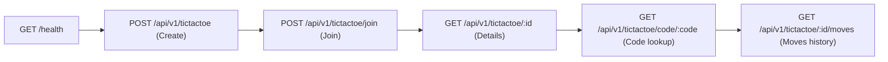

# Complete Postman Testing Guide: Tic-Tac-Toe Multiplayer Game

This guide provides end-to-end, step-by-step instructions for testing the **Tic-Tac-Toe Multiplayer Game** backend using **Postman**. It covers server setup, importing the Postman collection, executing all REST API HTTP endpoints (happy paths & edge cases), and performing real-time multiplayer testing using Postman's native **Socket.IO client** with two concurrent players (Host Alice & Guest Bob).

> 🔪 **Looking to test the Knife Game Multiplayer?**
> See the dedicated **[Knife Game Postman Testing Guide](KNIFE_GAME_POSTMAN_TESTING_GUIDE.md)** for testing knife throwing, clank/stick math, apple cuts, level progression, and rematch handling!

---

## Table of Contents

1. [Architecture & Game Rules Overview](#1-architecture--game-rules-overview)
2. [Prerequisites & Server Startup](#2-prerequisites--server-startup)
3. [Importing Collection into Postman](#3-importing-collection-into-postman)
4. [Collection Variables Setup](#4-collection-variables-setup)
5. [Testing REST API Endpoints (Step-by-Step)](#5-testing-rest-api-endpoints-step-by-step)
   - [Step 5.1: Health & Database Check (`GET /health`)](#step-51-health--database-check-get-health)
   - [Step 5.2: Create Game (Host - Player X) (`POST /api/v1/tictactoe`)](#step-52-create-game-host---player-x-post-apiv1tictactoe)
   - [Step 5.3: Join Game via Code (Guest - Player O) (`POST /api/v1/tictactoe/join`)](#step-53-join-game-via-code-guest---player-o-post-apiv1tictactoejoin)
   - [Step 5.4: Get Game Details by ID (`GET /api/v1/tictactoe/:id`)](#step-54-get-game-details-by-id-get-apiv1tictactoeid)
   - [Step 5.5: Get Game Details by Code (`GET /api/v1/tictactoe/code/:code`)](#step-55-get-game-details-by-code-get-apiv1tictactoecodecode)
   - [Step 5.6: Get Game Move History (`GET /api/v1/tictactoe/:id/moves`)](#step-56-get-game-move-history-get-apiv1tictactoeidmoves)
6. [Testing REST Validation & Error Cases](#6-testing-rest-validation--error-cases)
   - [Error 6.1: Missing `x-user-id` Header (`401 Unauthorized`)](#error-61-missing-x-user-id-header-401-unauthorized)
   - [Error 6.2: Non-existent Game Code (`404 Not Found`)](#error-62-non-existent-game-code-404-not-found)
   - [Error 6.3: Third Player Joins Full Game (`409 Conflict`)](#error-63-third-player-joins-full-game-409-conflict)
7. [Testing Real-Time Socket.IO Gameplay in Postman](#7-testing-real-time-socketio-gameplay-in-postman)
   - [Step 7.1: Opening Dual Postman Socket.IO Windows](#step-71-opening-dual-postman-socketio-windows)
   - [Step 7.2: Connection & Handshake Authentication](#step-72-connection--handshake-authentication)
   - [Step 7.3: Subscribing to Server Events](#step-73-subscribing-to-server-events)
   - [Step 7.4: Joining the Game Room (`ttt:game:join`)](#step-74-joining-the-game-room-tttgamejoin)
   - [Step 7.5: Playing a Full Game (Move by Move)](#step-75-playing-a-full-game-move-by-move)
   - [Step 7.6: Testing Turn Enforcement & Illegal Moves](#step-76-testing-turn-enforcement--illegal-moves)
   - [Step 7.7: Testing Win Detection & Game Over (`ttt:game:over`)](#step-77-testing-win-detection--game-over-tttgameover)
   - [Step 7.8: Testing Rematch / Restart with Symbol Swap (`ttt:restart`)](#step-78-testing-rematch--restart-with-symbol-swap-tttrestart)
   - [Step 7.9: Testing Voluntary Leave & Forfeit (`ttt:game:leave`)](#step-79-testing-voluntary-leave--forfeit-tttgameleave)
   - [Step 7.10: Testing 60-Second Disconnect & Forfeit Window](#step-710-testing-60-second-disconnect--forfeit-window)
8. [Running Automated Tests via Postman Collection Runner](#8-running-automated-tests-via-postman-collection-runner)
9. [Error Codes & Troubleshooting Reference](#9-error-codes--troubleshooting-reference)

---

## 1. Architecture & Game Rules Overview

The backend uses a **server-authoritative** multiplayer model:
- **Board Coordinates**: Single 9-element array index from `0` to `8`:
  ```text
   0 | 1 | 2
  ---+---+---
   3 | 4 | 5
  ---+---+---
   6 | 7 | 8
  ```
- **Player Assignment**:
  - Creator / Host is automatically assigned symbol **`X`**.
  - Joiner / Guest is automatically assigned symbol **`O`**.
  - **`X` always makes the first move**.
- **Turn Enforcement**: Moves submitted out of turn or on already occupied cells are rejected with an explicit error code.
- **Rematches**: On `ttt:restart`, symbols swap so the player who went second gets to play `X` and go first in the next round.
- **Forfeit Protection**: If a player disconnects mid-game, a **60-second grace timer** starts. If they do not reconnect within 60s, the opponent is automatically awarded the win by forfeit (`OPPONENT_DISCONNECTED`).

---

## 2. Prerequisites & Server Startup

### Step 2.1: Verify Node.js & Database
Make sure PostgreSQL is running and your `.env` file is configured:
```env
PORT=3000
NODE_ENV=development
DATABASE_URL=postgres://postgres@localhost:5432/drawing_widget_ios
DATABASE_SSL=false
```

### Step 2.2: Run Database Migrations
Apply the base schema and the Tic-Tac-Toe tables (`ttt_games`, `ttt_players`, `ttt_moves`):
```bash
npm run db:migrate
```

### Step 2.3: Start the Backend Server
```bash
npm run dev
```
You should see:
```text
[INFO] Socket.IO initialized on "/" and "/v1" namespaces
[INFO] Server running on port 3000 in development mode
```

> **Keep this terminal window running while testing.**

---

## 3. Importing Collection into Postman

You have two pre-configured collection files available in your repository:
- **Dedicated Tic-Tac-Toe Collection**: `tictactoe_postman_collection.json`
- **Full Backend Unified Collection**: `postman_collection.json`

### Import Instructions:
1. Open **Postman** (v10+ recommended).
2. Click **Import** in the upper left corner (or `Cmd + O` / `Ctrl + O`).
3. Select `tictactoe_postman_collection.json` from:
   ```text
   /Users/pc/Documents/Drawingwidgetiosdeploy/tictactoe_postman_collection.json
   ```
4. Click **Import**. You will see the collection **"Tic Tac Toe Multiplayer API & WebSockets"** in your sidebar.

---

## 4. Collection Variables Setup

Click on the collection name in Postman -> go to the **Variables** tab:

| Variable Name | Initial Value | Current Value | Description |
| :--- | :--- | :--- | :--- |
| `base_url` | `http://localhost:3000` | `http://localhost:3000` | Local server or Render URL |
| `ttt_user_host` | `ttt_user_host_001` | `ttt_user_host_001` | Host User ID (Player X) |
| `ttt_user_guest` | `ttt_user_guest_002` | `ttt_user_guest_002` | Guest User ID (Player O) |
| `ttt_game_id` | *(auto-populated)* | *(auto-populated)* | UUID of created game |
| `ttt_game_code` | *(auto-populated)* | *(auto-populated)* | 6-char alphanumeric room code |

> **Note**: Test scripts in the collection automatically capture `ttt_game_id` and `ttt_game_code` from responses and update the collection variables!

---

## 5. Testing REST API Endpoints (Step-by-Step)

Execute the requests in order:



---

### Step 5.1: Health & Database Check (`GET /health`)
Verifies server uptime and PostgreSQL database connection.

- **Method**: `GET`
- **URL**: `{{base_url}}/health`
- **Headers**: None required

#### Expected Response (`200 OK`):
```json
{
  "status": "ok",
  "database": "connected",
  "timestamp": "2026-11-12T03:40:00.000Z"
}
```

---

### Step 5.2: Create Game (Host - Player X) (`POST /api/v1/tictactoe`)
Creates a new game. Host is assigned symbol **`X`** and given a 6-character room code.

- **Method**: `POST`
- **URL**: `{{base_url}}/api/v1/tictactoe`
- **Headers**:
  - `Content-Type`: `application/json`
  - `x-user-id`: `{{ttt_user_host}}`
  - `devicetype`: `ios`
- **Body (raw JSON)**:
  ```json
  {
    "name": "Alice (Host)"
  }
  ```

#### Expected Response (`201 Created`):
```json
{
  "success": true,
  "data": {
    "game": {
      "id": "e4b3c2d1-0000-4000-8000-abcdef123456",
      "code": "G8H4Y2",
      "host_id": "ttt_user_host_001",
      "status": "waiting",
      "board": [null, null, null, null, null, null, null, null, null],
      "current_turn": null,
      "winner": null,
      "winning_line": null,
      "is_draw": false,
      "end_reason": null,
      "round": 1,
      "move_count": 0,
      "created_at": "2026-11-12T03:41:00.000Z",
      "started_at": null,
      "finished_at": null
    },
    "symbol": "X",
    "players": [
      {
        "user_id": "ttt_user_host_001",
        "symbol": "X",
        "name": "Alice (Host)",
        "profile_image": null,
        "device_type": "ios",
        "joined_at": "2026-11-12T03:41:00.000Z",
        "left_at": null
      }
    ]
  },
  "message": "Game created successfully."
}
```

#### Postman Test Script:
```javascript
pm.test("Status code is 201 Created", function () {
    pm.response.to.have.status(201);
});
pm.test("Host assigned symbol X and game code generated", function () {
    const json = pm.response.json();
    pm.expect(json.success).to.be.true;
    pm.expect(json.data.symbol).to.eql("X");
    pm.expect(json.data.game.status).to.eql("waiting");
    pm.expect(json.data.game.code).to.have.lengthOf(6);
    pm.collectionVariables.set("ttt_game_id", json.data.game.id);
    pm.collectionVariables.set("ttt_game_code", json.data.game.code);
});
```

---

### Step 5.3: Join Game via Code (Guest - Player O) (`POST /api/v1/tictactoe/join`)
Guest joins using the 6-character code. Assigned symbol **`O`**. Game status changes to **`playing`** and **`current_turn`** becomes **`X`**.

- **Method**: `POST`
- **URL**: `{{base_url}}/api/v1/tictactoe/join`
- **Headers**:
  - `Content-Type`: `application/json`
  - `x-user-id`: `{{ttt_user_guest}}`
  - `devicetype`: `ios`
- **Body (raw JSON)**:
  ```json
  {
    "code": "{{ttt_game_code}}",
    "name": "Bob (Guest)"
  }
  ```

#### Expected Response (`200 OK`):
```json
{
  "success": true,
  "data": {
    "game": {
      "id": "e4b3c2d1-0000-4000-8000-abcdef123456",
      "code": "G8H4Y2",
      "host_id": "ttt_user_host_001",
      "status": "playing",
      "board": [null, null, null, null, null, null, null, null, null],
      "current_turn": "X",
      "winner": null,
      "winning_line": null,
      "is_draw": false,
      "end_reason": null,
      "round": 1,
      "move_count": 0,
      "created_at": "2026-11-12T03:41:00.000Z",
      "started_at": "2026-11-12T03:41:15.000Z",
      "finished_at": null
    },
    "symbol": "O",
    "players": [
      {
        "user_id": "ttt_user_host_001",
        "symbol": "X",
        "name": "Alice (Host)"
      },
      {
        "user_id": "ttt_user_guest_002",
        "symbol": "O",
        "name": "Bob (Guest)"
      }
    ]
  },
  "message": "Joined game successfully."
}
```

---

### Step 5.4: Get Game Details by ID (`GET /api/v1/tictactoe/:id`)
Fetches full game metadata, board state, and players.

- **Method**: `GET`
- **URL**: `{{base_url}}/api/v1/tictactoe/{{ttt_game_id}}`
- **Headers**: None required

#### Expected Response (`200 OK`):
```json
{
  "success": true,
  "data": {
    "game": {
      "id": "e4b3c2d1-0000-4000-8000-abcdef123456",
      "code": "G8H4Y2",
      "status": "playing",
      "board": [null, null, null, null, null, null, null, null, null],
      "current_turn": "X"
    },
    "players": [
      { "user_id": "ttt_user_host_001", "symbol": "X" },
      { "user_id": "ttt_user_guest_002", "symbol": "O" }
    ]
  },
  "message": "Game details retrieved."
}
```

---

### Step 5.5: Get Game Details by Code (`GET /api/v1/tictactoe/code/:code`)
Allows frontend / iOS clients to preview a game before joining.

- **Method**: `GET`
- **URL**: `{{base_url}}/api/v1/tictactoe/code/{{ttt_game_code}}`
- **Headers**: None required

#### Expected Response (`200 OK`):
Returns the same payload as `GET /:id`.

---

### Step 5.6: Get Game Move History (`GET /api/v1/tictactoe/:id/moves`)
Returns chronological history of all moves made in the current round.

- **Method**: `GET`
- **URL**: `{{base_url}}/api/v1/tictactoe/{{ttt_game_id}}/moves`
- **Headers**: None required

#### Expected Response (`200 OK`):
```json
{
  "success": true,
  "data": {
    "moves": [
      {
        "id": "1",
        "round": 1,
        "move_number": 1,
        "user_id": "ttt_user_host_001",
        "symbol": "X",
        "cell_index": 0,
        "created_at": "2026-11-12T03:42:00.000Z"
      }
    ]
  },
  "message": "Game moves retrieved."
}
```

---

## 6. Testing REST Validation & Error Cases

### Error 6.1: Missing `x-user-id` Header (`401 Unauthorized`)
- **Method**: `POST`
- **URL**: `{{base_url}}/api/v1/tictactoe`
- **Headers**: `Content-Type: application/json` (Omit `x-user-id`)
- **Body**: `{ "name": "Anonymous" }`

#### Expected Response:
```json
{
  "success": false,
  "error": "Missing or invalid user id header (x-user-id)",
  "statusCode": 401
}
```

---

### Error 6.2: Non-existent Game Code (`404 Not Found`)
- **Method**: `POST`
- **URL**: `{{base_url}}/api/v1/tictactoe/join`
- **Headers**: `x-user-id: {{ttt_user_guest}}`, `Content-Type: application/json`
- **Body**: `{ "code": "ZZZZZZ", "name": "Bob" }`

#### Expected Response:
```json
{
  "success": false,
  "error": "No game found with code ZZZZZZ",
  "statusCode": 404
}
```

---

### Error 6.3: Third Player Joins Full Game (`409 Conflict`)
- **Method**: `POST`
- **URL**: `{{base_url}}/api/v1/tictactoe/join`
- **Headers**: `x-user-id: intruder_user_303`, `Content-Type: application/json`
- **Body**: `{ "code": "{{ttt_game_code}}", "name": "Charlie" }`

#### Expected Response:
```json
{
  "success": false,
  "error": "This game is full or has already ended",
  "statusCode": 409
}
```

---

## 7. Testing Real-Time Socket.IO Gameplay in Postman

Postman features a native **Socket.IO client** (support for Socket.IO v4).

### Step 7.1: Opening Dual Postman Socket.IO Windows
To simulate 2 real players, open two separate Postman tabs or windows:
1. In Postman, click **New** -> **Socket.IO**.
2. Save Tab 1 as **"Player 1 (Alice - Host X)"**.
3. Open a second Socket.IO tab and save it as **"Player 2 (Bob - Guest O)"**.

---

### Step 7.2: Connection & Handshake Authentication

Configure connection in each tab:

#### Tab 1 (Host Alice):
- **URL**: `http://localhost:3000/v1` *(or your Render URL: `https://your-service.onrender.com/v1`)*
- Click **Auth** tab -> Select **Type: None**
- Click **Headers** tab -> Add:
  - `x-user-id`: `ttt_user_host_001`
  - `devicetype`: `ios`
  - `name`: `Alice (Host)`
- *(Alternative)*: You can also pass authentication via the **Handshake Auth** JSON tab:
  ```json
  {
    "userId": "ttt_user_host_001",
    "devicetype": "ios",
    "name": "Alice (Host)"
  }
  ```
- Click **Connect**. The status pill will turn **Connected (green)**.

#### Tab 2 (Guest Bob):
- **URL**: `http://localhost:3000/v1`
- **Headers** tab:
  - `x-user-id`: `ttt_user_guest_002`
  - `devicetype`: `ios`
  - `name`: `Bob (Guest)`
- Click **Connect**. Status pill turns **Connected (green)**.

---

### Step 7.3: Subscribing to Server Events

Before playing, set both Postman tabs to listen for backend broadcast events.
Under the **Events** panel (bottom of each tab), add listeners for:

1. `ttt:player:joined`
2. `ttt:move:made`
3. `ttt:game:over`
4. `ttt:game:restarted`
5. `ttt:player:left`
6. `ttt:player:disconnected`
7. `app:error`

---

### Step 7.4: Joining the Game Room (`ttt:game:join`)

Both players must join the game room channel `ttt:<gameId>`.

#### 1. In Tab 1 (Alice):
- **Event Name**: `ttt:game:join`
- **Message format**: `JSON`
- **Enable Acknowledgement**: Check the **"Ack"** checkbox.
- **Message Body**:
  ```json
  {
    "game_id": "YOUR_GAME_ID_HERE"
  }
  ```
- Click **Send**.
- **Server Ack Response**:
  ```json
  {
    "ok": true,
    "your_symbol": "X",
    "game": { "status": "playing", "current_turn": "X", ... },
    "players": [ ... ]
  }
  ```

#### 2. In Tab 2 (Bob):
- **Event Name**: `ttt:game:join`
- **Enable Acknowledgement**: Check **"Ack"**.
- **Message Body**:
  ```json
  {
    "game_id": "YOUR_GAME_ID_HERE"
  }
  ```
- Click **Send**.
- **Server Ack Response**:
  ```json
  {
    "ok": true,
    "your_symbol": "O",
    "game": { "status": "playing", "current_turn": "X", ... },
    "players": [ ... ]
  }
  ```
- **Alice's Tab 1 will simultaneously receive event**:
  `ttt:player:joined` with Bob's details!

---

### Step 7.5: Playing a Full Game (Move by Move)

We will execute a top-row victory for Alice:
```text
  X | X | X    <- Alice (X) wins cells 0, 1, 2
 ---+---+---
  O | O | .    <- Bob (O) plays cells 3, 4
 ---+---+---
  . | . | .
```

#### Move 1: Alice (X) plays Cell 0 (Top-Left)
- **Tab 1 (Alice)**:
  - Event: `ttt:move`
  - Ack: Checked
  - Body:
    ```json
    { "cell_index": 0 }
    ```
  - Click **Send**.
  - **Ack Output**:
    ```json
    {
      "ok": true,
      "cell_index": 0,
      "symbol": "X",
      "move_number": 1,
      "next_turn": "O",
      "board": ["X", null, null, null, null, null, null, null, null],
      "game_over": false
    }
    ```
- **Tab 2 (Bob)**:
  - Instantly receives event `ttt:move:made` showing Alice's move!

---

### Step 7.6: Testing Turn Enforcement & Illegal Moves

#### Negative Test A: Bob tries to move out of turn
In Tab 2 (Bob), try sending:
- Event: `ttt:move`
- Body: `{ "cell_index": 4 }`
- **Server Ack Output**:
  ```json
  {
    "ok": false,
    "code": "MOVE_FAILED",
    "message": "It is not your turn",
    "reason": "NOT_YOUR_TURN"
  }
  ```
  *(Correctly rejected!)*

#### Negative Test B: Alice tries to play on an occupied cell
In Tab 1 (Alice), try playing Cell 0 again:
- Event: `ttt:move`
- Body: `{ "cell_index": 0 }`
- **Server Ack Output**:
  ```json
  {
    "ok": false,
    "code": "MOVE_FAILED",
    "message": "That cell is already taken",
    "reason": "CELL_OCCUPIED"
  }
  ```

---

#### Move 2: Bob (O) plays Cell 3 (Middle-Left)
- **Tab 2 (Bob)**:
  - Event: `ttt:move`
  - Body: `{ "cell_index": 3 }`
  - Click **Send**.
  - **Ack**: `next_turn: "X"`, `board[3]: "O"`.
- **Tab 1 (Alice)** receives `ttt:move:made`.

#### Move 3: Alice (X) plays Cell 1 (Top-Middle)
- **Tab 1 (Alice)**:
  - Event: `ttt:move`
  - Body: `{ "cell_index": 1 }`
  - Click **Send**.
- **Tab 2 (Bob)** receives `ttt:move:made`.

#### Move 4: Bob (O) plays Cell 4 (Center)
- **Tab 2 (Bob)**:
  - Event: `ttt:move`
  - Body: `{ "cell_index": 4 }`
  - Click **Send**.
- **Tab 1 (Alice)** receives `ttt:move:made`.

---

### Step 7.7: Testing Win Detection & Game Over (`ttt:game:over`)

#### Move 5: Alice (X) plays Cell 2 (Top-Right) -> Winning Move!
- **Tab 1 (Alice)**:
  - Event: `ttt:move`
  - Body: `{ "cell_index": 2 }`
  - Click **Send**.
- **Server Ack Output**:
  ```json
  {
    "ok": true,
    "cell_index": 2,
    "symbol": "X",
    "move_number": 5,
    "next_turn": null,
    "game_over": true,
    "winner": "X",
    "winning_line": [0, 1, 2],
    "is_draw": false
  }
  ```
- **Both Tab 1 & Tab 2 receive broadcast event `ttt:game:over`**:
  ```json
  {
    "game_id": "YOUR_GAME_ID",
    "status": "finished",
    "winner": "X",
    "winner_user_id": "ttt_user_host_001",
    "winning_line": [0, 1, 2],
    "is_draw": false,
    "reason": "WIN",
    "board": ["X", "X", "X", "O", "O", null, null, null, null]
  }
  ```

---

### Step 7.8: Testing Rematch / Restart with Symbol Swap (`ttt:restart`)

When a game is finished, either player can request a rematch. The backend swaps symbols so the loser / second player gets to play `X` and start first.

- **In Tab 1 or Tab 2**:
  - Event: `ttt:restart`
  - Ack: Checked
  - Body: `{}`
  - Click **Send**.
- **Server Ack Output**:
  ```json
  {
    "ok": true,
    "status": "playing",
    "move_count": 0,
    "your_symbol": "O",
    "game": {
      "round": 2,
      "status": "playing",
      "board": [null, null, null, null, null, null, null, null, null],
      "current_turn": "X"
    }
  }
  ```
- **Both tabs receive broadcast event `ttt:game:restarted`**:
  ```json
  {
    "game_id": "YOUR_GAME_ID",
    "restarted_by": "ttt_user_host_001",
    "game": { "round": 2, "status": "playing" },
    "players": [
      { "user_id": "ttt_user_host_001", "symbol": "O" },
      { "user_id": "ttt_user_guest_002", "symbol": "X" }
    ]
  }
  ```
  *(Notice: Bob is now `X` and goes first!)*

---

### Step 7.9: Testing Voluntary Leave & Forfeit (`ttt:game:leave`)

If a player leaves an active game, the opponent is automatically awarded the win by forfeit.

- **In Tab 2 (Bob)**:
  - Event: `ttt:game:leave`
  - Ack: Checked
  - Body: `{}`
  - Click **Send**.
- **Ack Output**:
  ```json
  {
    "ok": true,
    "game_abandoned": true
  }
  ```
- **Tab 1 (Alice) instantly receives**:
  1. Event `ttt:player:left`: `{ "game_id": "...", "user_id": "ttt_user_guest_002" }`
  2. Event `ttt:game:over`:
     ```json
     {
       "game_id": "...",
       "status": "abandoned",
       "winner": "O",
       "winner_user_id": "ttt_user_host_001",
       "reason": "OPPONENT_LEFT"
     }
     ```

---

### Step 7.10: Testing 60-Second Disconnect & Forfeit Window

1. Start a new game and have both players join.
2. In Tab 2 (Bob), click **Disconnect** (simulating network drop or app killed).
3. In Tab 1 (Alice), observe the immediate receipt of event `ttt:player:disconnected`:
   ```json
   {
     "game_id": "YOUR_GAME_ID",
     "user_id": "ttt_user_guest_002",
     "timeout_ms": 60000
   }
   ```
4. If Bob reconnects within 60 seconds and emits `ttt:game:join`, the forfeit timer is cancelled and the game continues.
5. If Bob does **not** reconnect within 60 seconds, Tab 1 receives `ttt:game:over` with `reason: "OPPONENT_DISCONNECTED"` and Alice is awarded the win!

---

## 8. Running Automated Tests via Postman Collection Runner

You can execute all HTTP tests automatically:

1. Click on the collection **"Tic Tac Toe Multiplayer API & WebSockets"**.
2. Click **Run** in the top navigation bar.
3. Select the folder **"2. Tic Tac Toe REST Endpoints"**.
4. Set **Iterations**: `1`, **Delay**: `0 ms`.
5. Click **Run Tic Tac Toe Multiplayer API & WebSockets**.
6. **Result**: All assertions (status 200/201, symbol assignment, code validation, error responses) pass with **100% Green Checks**.

---

## 9. Error Codes & Troubleshooting Reference

### Common Error Codes in `app:error` & Socket ACKs:

| Reason / Code | Description | Resolution |
| :--- | :--- | :--- |
| `NOT_IN_GAME` | Socket has not emitted `ttt:game:join` | Emit `ttt:game:join` with valid `game_id` first |
| `NOT_YOUR_TURN` | Player attempted a move when it is opponent's turn | Wait for opponent to move or check `current_turn` |
| `CELL_OCCUPIED` | Cell is already taken by 'X' or 'O' | Choose an unoccupied cell index (0 to 8) |
| `INVALID_CELL` | `cell_index` is not an integer 0..8 | Pass an integer between `0` and `8` |
| `GAME_NOT_ACTIVE` | Move submitted on finished/abandoned game | Request rematch with `ttt:restart` |
| `GAME_NOT_FINISHED` | `ttt:restart` called during active game | Play until game finishes or player leaves |
| `OPPONENT_LEFT` | Rematch attempted after opponent left | Opponent must re-join or create new game |
| `RATE_LIMIT_EXCEEDED` | Exceeded 120 actions/sec limit | Throttle socket emits |

---

## Quick Reference cURL Commands

If you want to test REST endpoints via CLI alongside Postman:

```bash
# 1. Create Game
curl -X POST http://localhost:3000/api/v1/tictactoe \
  -H "Content-Type: application/json" \
  -H "x-user-id: host_alice" \
  -H "devicetype: ios" \
  -d '{"name":"Alice"}'

# 2. Join Game
curl -X POST http://localhost:3000/api/v1/tictactoe/join \
  -H "Content-Type: application/json" \
  -H "x-user-id: guest_bob" \
  -H "devicetype: ios" \
  -d '{"code":"ENTER_6_CHAR_CODE","name":"Bob"}'

# 3. Lookup Game by Code
curl http://localhost:3000/api/v1/tictactoe/code/ENTER_6_CHAR_CODE

# 4. View Move History
curl http://localhost:3000/api/v1/tictactoe/ENTER_GAME_UUID/moves
```

